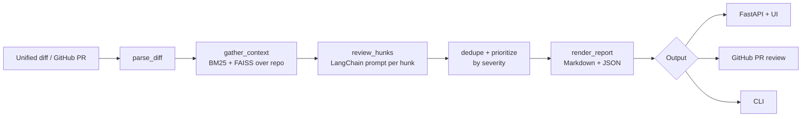

# AI Code Review Agent 🤖

An AI-powered code review agent that reviews pull requests and code
diffs, and posts actionable, specific review comments — with exact
file + line citations, severities, and a verdict.

It is an **agent**, not a one-shot prompt: before reviewing a hunk it
retrieves context from the repository itself (hybrid BM25 + FAISS
search over the codebase), so it can check whether a changed function
is used elsewhere, whether a pattern already exists, and whether the
change breaks an existing convention. The review runs as an explicit
LangGraph state machine, and the output is a structured report that
can be posted as a GitHub PR review.

## What it checks

| Category | Examples |
| --- | --- |
| 🐛 Bugs | Mutable default arguments, bare `except:`, N+1-adjacent logic errors, `assert` in production code |
| 🔒 Security | SQL / command injection, hardcoded secrets, unsafe deserialization (`pickle`, `yaml.load`), TLS verification disabled, weak crypto (MD5/SHA-1), insecure randomness for tokens |
| ⚡ Performance | N+1 queries (DB call inside a loop), repeated work in loops |
| 🎨 Style | `== None` (use `is None`), `print()` in production code, TODO/FIXME left in |
| 🧪 Testing | New public behaviour with no test (real-LLM path) |
| 🧱 Maintainability | Very long functions, duplicated logic |

Every finding cites the exact file and new-file line range, carries
a severity (`critical` / `major` / `minor` / `nit`), and includes a
concrete suggested fix (with a code snippet where useful).

**Verdict:** any `critical` finding → `request_changes`; `major` /
`minor` → `comment`; only nits (or nothing) → `approve`.

## Architecture



- **Diff parsing** (`src/cra/diff_parser.py`) — dependency-free unified
  diff parser; tracks exact new-file line numbers for citations.
- **RAG context** (`src/cra/context.py`) — repo files chunked into
  overlapping windows, indexed with BM25 + FAISS, fused by Reciprocal
  Rank Fusion. Function/class names defined in a hunk are also looked
  up to find their usages.
- **Review** (`src/cra/reviewer.py`, `src/cra/llm.py`) — a LangChain
  chain per hunk: `PromptTemplate` → provider → `StrOutputParser`.
  Providers: `mock` (deterministic rule engine, offline), `openai`
  (ChatOpenAI), `huggingface` (local instruct model).
- **Pipeline** (`src/cra/pipeline.py`) — LangGraph state machine:
  `parse_diff → gather_context → review_hunks → dedupe_prioritize →
  render_report`.
- **GitHub** (`src/cra/github_client.py`) — fetch a PR as a diff and
  post the report as a PR review (inline comments + verdict) via
  `httpx`. Token from `GITHUB_TOKEN` only.
- **Eval** (`src/cra/evaluation.py`, `eval_data/`) — sample diffs
  with expected findings; scores precision, recall, F1,
  false-positive rate and citation accuracy.

## Quick start

```bash
git clone https://github.com/rohithsadanala/ai-code-review-agent.git
cd ai-code-review-agent
python -m venv .venv && source .venv/bin/activate
pip install -r requirements.txt && pip install -e .
```

Runs fully offline by default (mock LLM + fake embeddings, no keys):

```bash
# Review a diff file
cra review examples/pr.diff

# Review with repo context (RAG over the codebase)
cra review examples/pr.diff --repo /path/to/repo

# Review a GitHub PR (needs GITHUB_TOKEN)
cra review --pr octocat/hello-world#42

# Start the API + web UI
cra serve   # http://127.0.0.1:8000

# Run the eval harness
cra eval
```

### Using a real LLM

```bash
export CRA_LLM_PROVIDER=openai
export OPENAI_API_KEY=sk-...
cra review examples/pr.diff
```

Or a local model (needs `requirements-optional.txt`):

```bash
pip install -r requirements-optional.txt
export CRA_LLM_PROVIDER=huggingface
export CRA_LLM_MODEL=HuggingFaceH4/zephyr-7b-beta
```

### Posting a review to GitHub

```bash
export GITHUB_TOKEN=ghp_...
# via the API:
curl -X POST http://127.0.0.1:8000/reviews/<id>/post-to-github \
  -H 'Content-Type: application/json' \
  -d '{"owner": "octocat", "repo": "hello-world", "number": 42}'
```

## API reference

| Method | Endpoint | Description |
| --- | --- | --- |
| `GET` | `/health` | Liveness + provider info |
| `GET` | `/` | Single-page web UI |
| `POST` | `/reviews` | Submit a diff (or `pr: "owner/repo#n"`) and run a review |
| `GET` | `/reviews` | List past review summaries |
| `GET` | `/reviews/{id}` | Full report (JSON + Markdown) |
| `POST` | `/reviews/{id}/post-to-github` | Post the report as a PR review |
| `GET` | `/docs` | OpenAPI docs |

`POST /reviews` body:

```json
{
  "diff": "diff --git a/app.py b/app.py\n...",
  "repo_path": "/path/to/repo",
  "pr": "owner/repo#42"
}
```

## Eval results

`python scripts/run_eval.py` on the shipped 4-case eval set
(mock LLM, offline):

| Case | Expected | Reported | Precision | Recall | F1 |
| --- | --- | --- | --- | --- | --- |
| clean-code | 0 | 0 | 1.000 | 1.000 | 1.000 |
| real-bug | 2 | 2 | 1.000 | 1.000 | 1.000 |
| security-flaw | 2 | 2 | 1.000 | 1.000 | 1.000 |
| style-issues | 3 | 3 | 1.000 | 1.000 | 1.000 |

Mean precision 1.000, mean recall 1.000, mean F1 1.000,
false-positive rate 0.000, citation accuracy 1.000.
Full results: [`eval_data/eval_results.json`](eval_data/eval_results.json).

> The eval set is tuned for the mock LLM's deterministic rules, so
> these numbers measure the rule engine, not a real model's
> judgement. With `CRA_LLM_PROVIDER=openai` the same harness runs
> against the model — expect lower precision/recall and a higher
> false-positive rate, which is the honest trade-off of a generative
> reviewer. The citation-accuracy metric exists precisely to catch
> hallucinated line numbers.

## Configuration

All settings are environment variables (see `.env.example`):

| Variable | Default | Description |
| --- | --- | --- |
| `CRA_LLM_PROVIDER` | `mock` | `mock` \| `openai` \| `huggingface` |
| `CRA_LLM_MODEL` | `gpt-4o-mini` | Model for the OpenAI / HF provider |
| `OPENAI_API_KEY` | — | OpenAI key (env only) |
| `CRA_EMBEDDING_PROVIDER` | `fake` | `fake` \| `huggingface` \| `openai` |
| `CRA_EMBEDDING_MODEL` | `all-MiniLM-L6-v2` | Embedding model |
| `CRA_MAX_FINDINGS` | `25` | Cap on findings in a report |
| `CRA_CONTEXT_K` | `3` | Repo-context chunks per hunk |
| `CRA_REPO_PATH` | — | Default repo for RAG context |
| `CRA_DATA_DIR` | `./data` | Persisted review reports |
| `GITHUB_TOKEN` | — | GitHub token (env only) |
| `CRA_HOST` / `CRA_PORT` | `127.0.0.1:8000` | Server bind |

## Docker

```bash
docker compose up --build   # UI at http://localhost:8000
```

The compose file mounts `./data` for persisted reports; mount a
repo read-only at `/repos/target` to review it with RAG context.

## Limitations

- The mock LLM only implements the deterministic rule subset — it
  cannot judge design, spot subtle logic bugs, or check test
  coverage. Use a real LLM provider for those.
- The rule engine is Python-focused; other languages get the
  generic checks (secrets, long functions, TODOs) and whatever the
  real LLM finds.
- GitHub posting needs a token with `pull_requests: write` scope.

## Roadmap

- [ ] Multi-language rule packs (TypeScript/JavaScript, Java, Go)
- [ ] ChromaDB / pgvector as the context store (currently FAISS in-memory)
- [ ] Incremental re-review: only re-review changed hunks on push
- [ ] DeepEval-based LLM-judged eval for the generative path
- [ ] Severity calibration from repo history (which findings get fixed)

## License

MIT — see [LICENSE](LICENSE).
